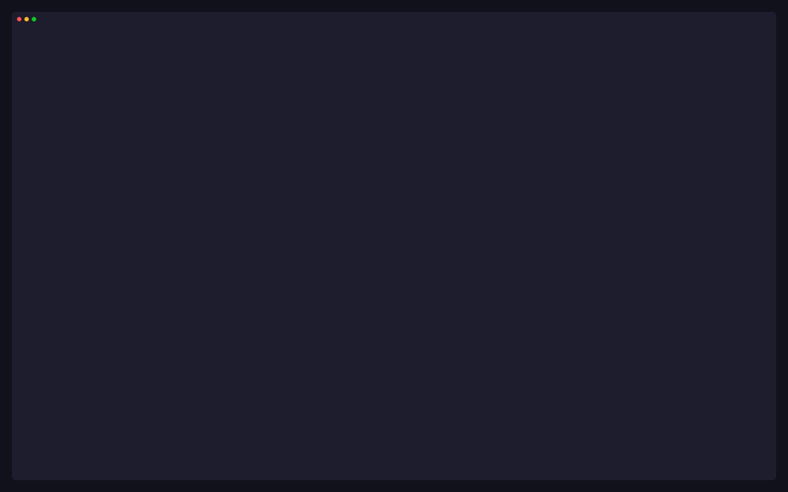
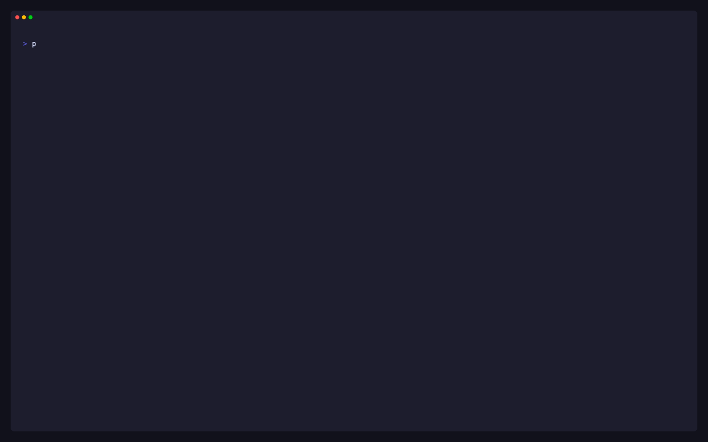
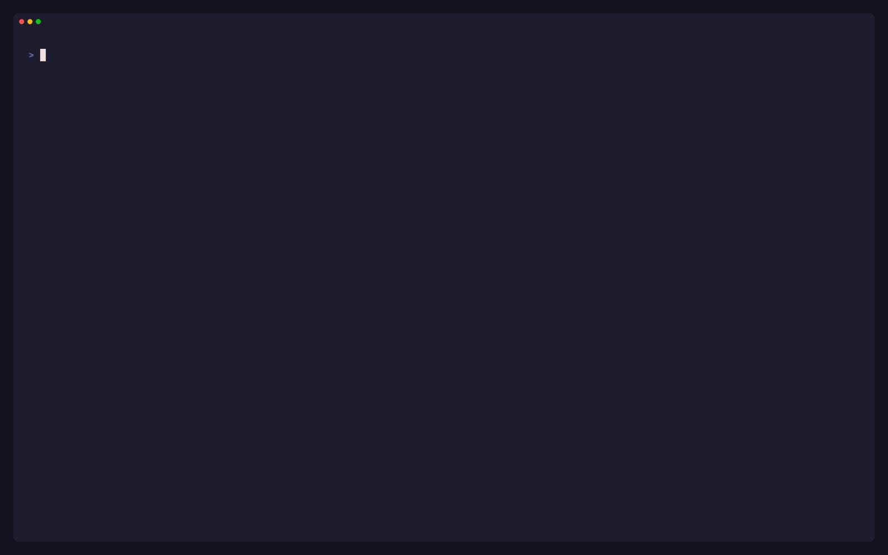

<div align="center">

# p9s

**A terminal UI for Kubernetes policy engines** — in the spirit of [k9s](https://k9scli.io).

Browse policies, violations, admission denials and engine health for
**OPA Gatekeeper**, **Kyverno** and native **ValidatingAdmissionPolicies**,
side by side, straight from your kubeconfig.

[](https://github.com/yindia/p9s/actions/workflows/ci.yml)
[](https://github.com/yindia/p9s/releases)
[](go.mod)
[](https://goreportcard.com/report/github.com/yindia/p9s)

[Install](#-install) · [Quick start](#-quick-start) · [Features](#%EF%B8%8F-the-tui) · [CLI](#%EF%B8%8F-command-line) · [Contributing](#-contributing)


</div>

## ✨ Why p9s

p9s answers the questions a platform or security team asks every day:

- 🩺 **Is the policy layer working?** Fail-open webhooks with no endpoints,
  expiring certificates, crash-looping controllers, stale audits, policies
  that never loaded.
- 👥 **What is violating what, and whose is it?** Violations grouped by the
  Deployment or CronJob that owns them, or by team label.
- 💥 **What would break if this policy enforced?** The objects a policy would
  reject today, by namespace and owner.
- 🚫 **What was just blocked?** Recent admission denials, with the user who
  made the request.
- 🛠️ **How do I fix it?** A violation's detail carries the policy's own
  remediation text.
- 📄 **Can I hand this to security?** `p9s report` writes Markdown, HTML or
  JSON with Pod Security Standards coverage and health findings.

And it stays out of the way:

- 🔒 **Read-only.** Nothing to install in the cluster; p9s never creates,
  changes or deletes anything.
- ⚡ **Live.** Informers, not polling, with trimmed caches.
- 🔐 **RBAC-aware.** Works with whatever you may read, down to a single
  namespace, and says what it could not see.
- 📸 **Offline.** Record a snapshot and browse it anywhere, or run the same
  views as `p9s get` in scripts and CI.

## 📚 Contents

- [Install](#-install) · [Quick start](#-quick-start) · [Engines](#-engines)
- [The TUI](#%EF%B8%8F-the-tui): [overview](#overview), [violations by owner](#violations-by-owner-and-team),
  [violation detail](#violation-detail-and-how-to-fix), [enforcement impact](#enforcement-impact),
  [admission events](#recent-admission-events), [health](#health-dashboard),
  [engine views](#engine-views)
- [Navigating](#-navigating): [commands](#commands), [keys](#keys), [filtering](#filtering),
  [namespace scope](#namespace-scope), [header](#header), [reading tables](#reading-tables)
- [Command line](#%EF%B8%8F-command-line): [`get`](#p9s-get), [`snapshot`](#p9s-snapshot), [`report`](#p9s-report),
  [config file](#config-file), [flags](#flags)
- [Access and RBAC](#-access-and-rbac) · [Development](#%EF%B8%8F-development) ·
  [Contributing](#-contributing) · [Security](#-security)

## 📦 Install

**🍺 Homebrew** (the formula lives in this repository):

```sh
brew tap yindia/p9s https://github.com/yindia/p9s
brew install p9s
```

**📜 Install script** (macOS, Linux and Windows on amd64/arm64; verifies the
release checksum):

```sh
curl -sSfL https://raw.githubusercontent.com/yindia/p9s/main/install.sh | sh -s -- -b /usr/local/bin
# a specific release: ... | sh -s -- -b /usr/local/bin v0.1.0
```

**🐹 Go**:

```sh
go install github.com/yindia/p9s/cmd/p9s@latest
```

**From a checkout**: `make build && ./bin/p9s`. Binaries for every
platform are also attached to each
[release](https://github.com/yindia/p9s/releases).

## 🚀 Quick start

```sh
p9s                          # current context, every engine it finds
p9s --context prod           # another kubeconfig context
p9s -c v                     # start on the violations view
p9s --group-label team       # group violations by the owners' team label

p9s get pol                  # the policies table, printed and done
p9s report -o report.md      # a security report
```

> [!TIP]
> No cluster handy? `make e2e-up` builds a kind cluster with Gatekeeper and
> the gatekeeper-library, Kyverno with the restricted Pod Security policies,
> some demo workloads and native VAPs: what every recording here shows.

## 🧩 Engines

Engines are detected through discovery when p9s starts and on every context
switch. Several can be active at once: the shared views merge them with an
`ENGINE` column.

| Engine | Detected by | Policies | Violations |
|---|---|---|---|
| **Gatekeeper** | `templates.gatekeeper.sh` | constraints (kinds discovered at runtime; a new template appears without a restart) | constraint `status.violations` (capped by `--constraint-violations-limit`, with `totalViolations` as the real count) |
| **Kyverno** | `kyverno.io` / `policies.kyverno.io` | ClusterPolicies, Policies and the CEL family (ValidatingPolicy, ImageValidatingPolicy, Mutating, Generating, Deleting, namespaced variants) | PolicyReport and ClusterPolicyReport results |
| **vap** | `admissionregistration.k8s.io` serves ValidatingAdmissionPolicies | native policies, with enforcement from their bindings | PolicyReport results Kyverno writes for VAPs, when enabled |

All data comes from informers. Nothing polls, and caches drop
`managedFields` and kubectl's last-applied copy. A new engine implements
one interface; see [docs/adding-an-engine.md](docs/adding-an-engine.md).

## 🖥️ The TUI

### Overview

The start view (`:overview`, `:ov`) answers "is the policy layer working,
and what should I look at first" on one screen. `j`/`k` select a block,
`enter` opens it, `esc` comes back.

| Block | Shows | `enter` opens |
|---|---|---|
| Health | critical / warning / ok counts and the worst checks | `:health` |
| Top violating owners | the owners (Deployments, CronJobs, …, or `--group-label` values) with most affected objects | `:v` |
| Enforcement candidates | policies in audit or warn mode, fewest violations first: those with none can enforce without blocking anything that exists today | `:pol /mode:audit,warn` |
| Recent admission denials | the latest requests a policy blocked | `:events` |
| Exemptions | not available yet | |

The overview follows the `:ns` scope.


### Violations by owner and team

`:v` and a policy's drill-down group violations by the target's
**top-level owner**, so a Deployment with 30 violating Pods is one row with
`OBJECTS 30`:

```
  ENGINE      OWNER                         POLICY                      KIND          ACTION   OBJECTS↓  MESSAGE
▸ gatekeeper  Deployment/p9s-demo/checkout  container-must-have-limits  K8sContainer… enforce  3         container <web> has no resource limits
```

- Owners come from controller ownerReferences: Pod → ReplicaSet →
  Deployment, Pod → Job → CronJob, Pod → StatefulSet, Pod → DaemonSet.
  The original target is kept.
- `enter` expands a group, `g` goes to the owner, `o` switches to the flat
  list (one row per violation).
- With `--group-label team`, `t` groups by the owner's `team` label,
  falling back to the namespace's, then `(none)`.
- Ownership uses metadata-only informers (about 3 MiB on the e2e cluster).
  If RBAC hides some kinds, violations group under the deepest owner p9s
  can see and a notice names the missing kinds.

### Violation detail and how to fix


`d` on a violation is written for the developer who has to fix it: the full
message, the target and its owner, the policy with its normalised
enforcement, and **How to fix**, taken from the policy's own metadata:

- Kyverno: `policies.kyverno.io/title` and `policies.kyverno.io/description`.
- Gatekeeper: the constraint's `description` annotation, then the
  template's `metadata.gatekeeper.sh/title` and `description` (set by
  gatekeeper-library).

Each item says where it came from; a policy without any says so. `y` shows
the policy's YAML and `g` goes to the target.

### Enforcement impact


`i` on any policy or violation row (or `:impact <policy>`) shows what
moving the policy to enforce would block: its current violations by
namespace, then owner.

- The headline uses the engine's own total. When Gatekeeper lists fewer
  violations than it counts, the view says "showing N of M" and its groups
  cover only the listed ones. A capped list is never shown as complete.
- `MANAGED` says how each owner would be hit: `controller` (new Pods and
  rollouts may be rejected), `bare` (its next update may be), or `-` when
  p9s cannot see its owners.
- Enforcing rejects matching creates and updates; running objects keep
  running. No audit data means the impact is unknown, not zero.
- The view is cluster-wide. `enter` lists an owner's violations.

### Recent admission events


Audit results say what is wrong **now**. The recent tab of `:v` (`]`, or
`:events`) says what was **blocked or flagged at admission**, from the
Events the engines write: time, engine, policy, action, user, target and
message. `[` returns to the audit results with their grouping.

- **Gatekeeper** writes `FailedAdmission`, `WarningAdmission` and
  `DryrunViolation` Events, **only with `--emit-admission-events`** (Helm
  `emitAdmissionEvents=true`). p9s reads the flag and says when it is off.
- **Kyverno** writes `PolicyViolation` Events from `kyverno-admission`.
  `ACTION` is `enforce` when the request was blocked and `audit`/`warn`
  when it was let through. Kyverno does not record the user.
- Only matching Events are cached (server-side field selectors). Events
  expire (`--event-ttl`, 1 hour by default), so this is recent history.
  Server-side dry runs are recorded like real requests; denials by
  generated VAPs are not recorded as Events.

### Health dashboard

`:health` checks the policy layer itself, worst first. `tab` moves between
panels, `enter` opens a row's detail, `g` goes to the object behind it.

```
  OVERALL   ✗ 2 critical   ! 1 warning   ✓ 25 ok                                      refreshed 2s ago
─ Webhooks [11] ────────────────────────────────────────────────────────────────────────────────────
  ENGINE      WEBHOOK                    FAILURE  TIMEOUT  ENDPOINTS  CERT   STATUS
▸ gatekeeper  fail-open.p9s.example      Ignore   3s       0/0        -      ✗ fail-open, no endpoints
  gatekeeper  validation.gatekeeper.sh   Ignore   3s       3/3        3649d  ✓
```

| Panel | Shows | ✗ critical / ! warning |
|---|---|---|
| Webhooks | each webhook of the engines: failure policy, timeout, ready endpoints / total, earliest certificate expiry | ✗ `Ignore` with no ready endpoints (policy silently bypassed). ! `Fail` with none (admission blocked). ! certificate expiring within 14 days |
| Controllers | the engines' Deployments: ready / desired, restarts, last termination reason, image tag | ✗ none ready. ! a restart in the last hour, or mismatched image tags |
| Audit | source, interval, last run, leader | ! older than 2× the interval, or never run |
| Policies | loaded / total, not enforced, compile errors, missing CRDs, not ready | ✗ a VAP binding to a missing policy, or a missing param that rejects every request. ! any other inactive policy |

The webhook detail explains the failure policy, endpoints with Pod state,
the certificate, namespace and object selectors, rules, and the impact in
one line.

### Engine views

Engine views are reached by drilling down from a policy, or directly with
their `:` command. Kinds are shortened in tables (`CPol`, `VPol`, `VAP`, …)
and spelled out in details.

**Gatekeeper**

| Command | View |
|---|---|
| `:gk/ct` | ConstraintTemplates: kind, language, constraint count. `d`: highlighted Rego/CEL and the parameters schema. `enter`: its constraints |
| `:gk/c` | Constraints: enforcement, violations, audit age. `d`: match, parameters, violations (reported vs. total). `enter`: its violations |
| `:gk/cfg` | the Gatekeeper Config: sync list, exclusions, readiness |

**Kyverno**

| Command | View |
|---|---|
| `:kyv/cpol`, `:kyv/pol` | ClusterPolicies and Policies: action (per-rule `failureAction` honoured), ready, rules, violations |
| `:kyv/vpol` | the CEL `policies.kyverno.io` kinds. `d`: match constraints and highlighted CEL |
| `:kyv/polr` | PolicyReports per resource with pass/fail/warn/error/skip |
| `:kyv/polex` | PolicyExceptions (classic and CEL) and what they exempt |

Classic `Enforce`/`Audit` and CEL `Deny`/`Warn`/`Audit` map to enforce,
warn and audit (the strictest action wins). `fail`, `warn` and `error`
report results are violations; results for deleted policies are summarised
in `:health`. Mutations appear in `:mut`.

**Native ValidatingAdmissionPolicies (`vap`)**



| Command | View |
|---|---|
| `:vap/pol` | policies: failure policy, param kind, bindings, enforcement, generated by. `d`: match constraints, highlighted CEL, match conditions, variables, type-checking warnings and every binding. `enter`: its bindings. `G`: show generated policies |
| `:vap/b` | bindings: policy, actions, param, match resources |

- Enforcement is the strictest `validationActions` across a policy's
  bindings. With no binding it is `n/a`, and `:health` says it is not
  bound.
- The API server keeps no audit of VAPs. Counts come from PolicyReport
  results Kyverno writes for them (`features.validatingAdmissionPolicyReports`);
  without those they are `-`, never 0.
- **Generated VAPs**: Gatekeeper and Kyverno can generate VAPs from their
  own policies. p9s recognises them (Gatekeeper's are owned by their
  ConstraintTemplate; Kyverno's by the ValidatingPolicy), keeps them out of
  the `vap` engine's counts, and lists them under "Generated admission
  policies" in the source policy's `:pol` detail. `G` in `:vap/pol` shows
  them.
- Health: bindings to missing policies, missing param objects (checked in
  the background, never on a read), type-checking warnings, unbound
  policies.

## 🧭 Navigating

### Commands

| Command | View |
|---|---|
| `:overview` `:ov` | the start view |
| `:pol [engine]` | policies from every active engine |
| `:v [engine]` | violations; `[` `]` switch between audit results and recent admission events |
| `:events` | recent admission events (the recent tab of `:v`) |
| `:impact <policy>` | what enforcing a policy would block (`name`, `kind/name` or `engine:kind/name`) |
| `:mut [engine]` | mutations, from engines that report them |
| `:health` | the health dashboard |
| `:ns [name\|all]` | namespaces with violation counts; picks the [namespace scope](#namespace-scope) |
| `:ctx` | kubeconfig contexts; `enter` switches, and engines are detected again |
| `:gk/…` `:kyv/…` `:vap/…` | [engine views](#engine-views) |
| `:q` | quit |

`tab` completes commands; `?` lists every command, including engine views.

### Keys

| Key | Action |
|---|---|
| `:` | command mode |
| `/` | filter rows (live); `esc` clears |
| `enter` | drill down or open; else describe |
| `esc` | clear the filter, else go back |
| `d` | describe |
| `y` | YAML (managedFields stripped, Secret values redacted) |
| `e` | open the YAML in `$VISUAL`/`$EDITOR` (read-only: changes are discarded) |
| `g` | go to the object behind the row |
| `c` / `C` | copy `kind/namespace/name`, or a `kubectl get … -o yaml` command (OSC 52, works over SSH) |
| `i` | enforcement impact of the row's policy |
| `N` `V` `A` `S` | sort by name, violations, age, severity; again to reverse |
| `o` / `t` | `:v`: owner groups ↔ flat list / ↔ `--group-label` groups |
| `[` `]` | `:v`: audit results ↔ recent admission events |
| `G` | `:vap/pol`: show or hide generated policies (there `end` jumps to the last row) |
| `0` | clear the namespace scope |
| `j k ↑ ↓ pgup pgdn home end G` | move |
| `?` | help |
| `ctrl+c` `:q` | quit |

The footer lists only the keys that do something on the current row, and
messages there clear after 4 seconds.

### Filtering

`/` takes free text and column terms, combined with AND:

| Term | Matches |
|---|---|
| `owner` | any cell containing "owner" |
| `engine:kyverno` | the ENGINE column |
| `mode:audit` | the enforcement column (exact word; `mode:n/a` works) |
| `ns:payments` | the NAMESPACE column, or rows whose object is in `payments` |
| `kind:cpol` | the KIND column |
| `sev:error` | the SEVERITY column |
| `name:require` | the NAME or POLICY column |

A comma means "any of": `mode:audit,warn`, `engine:gatekeeper,kyverno` (no
spaces). A term for a column the view lacks matches nothing; unknown keys
(`foo:bar`) are free text, so messages with colons still match.

### Namespace scope

`:ns payments` (or picking a row in `:ns`) scopes every view: violations
whose target is in `payments` (including the `Namespace/payments` object),
cluster-wide policies plus policies in `payments` (their counts cover only
`payments`), and the same for `:health` and `:mut`. `0` or `:ns all`
clears it, as does switching context. The impact view, the health
dashboard's checks and reports stay cluster-wide and say so.

### Header

```
 p9s │ ctx kind-p9s │ ns all │ gatekeeper v3.23.1 · kyverno v1.19.2 · vap builtin │ last audit 28s ago (gatekeeper)   RO
```

The context, the namespace scope, active engines with their versions (from
the controller image, `unknown` if RBAC hides it), and audit freshness.
`last audit` names the engine whose audit is **stalest relative to its own
interval** (Gatekeeper's `--audit-interval`, Kyverno's
`--backgroundScanInterval`), turning amber past 2× and red past 5×.

While caches load, the header reads `syncing…` and counts that may still
change are drawn dimmed with a `~` (`~12`).

### Reading tables

- **Enforcement** is one word: `enforce`, `warn`, `audit`, `mutate` or
  `n/a`. The engine's own term is in the detail: `enforce (engine: deny)`.
- **`-` means not applicable or unknown** (a never-audited policy has no
  count). A dimmed `0` means none.
- **Names first**; kinds follow, dimmed and shortened.
- The active sort is marked in the header (`VIOLATIONS↓`), and the selected
  row's full message is under the table (`» …`).

## ⌨️ Command line

### `p9s get`


`p9s get <view>` prints the table the TUI shows, with the same columns,
default sort and filters, after every cache has synced.

```sh
p9s get pol
p9s get v -n payments --filter 'engine:kyverno sev:high'
p9s get impact require-team-label -o json
p9s get health -o json
p9s --context prod get gk/c
```

- Any `:` view works: `pol`, `v`, `events`, `mut`, `health`, `overview`,
  `ns`, `ctx`, `impact <policy>`, `gk/ct`, `kyv/polr`, `vap/pol`, ….
- `-o table` prints aligned text without truncation (it pipes into `grep`
  and `awk`); `-o json` prints the versioned `p9s/v1` table.
- `-n` is the namespace scope, `--filter` the `/` terms, `--sync-timeout`
  how long to wait for caches.
- RBAC notices and partial data are printed with the table, never hidden.

### `p9s snapshot`



```sh
p9s --context prod snapshot -o prod.json
p9s --snapshot prod.json                  # the TUI, offline
p9s --snapshot prod.json get v -o json
p9s --snapshot prod.json report
```

`snapshot` syncs like the TUI and records every answer the engines and
watchers received from the API server (lists, watches, gets, RBAC denials
and discovery). `--snapshot` replays it through the same engines, so every
view, detail and filter works as it did. The header shows
`snapshot <time>`, and ages are as of that time.

The file (`p9s/snapshot/v1`, mode `0600`) never carries Secret or ConfigMap
data, container env values, `managedFields` or kubectl's last-applied copy.
Policies, reports and workload specs are recorded as read: share it as you
would their `kubectl get -o yaml`.

### `p9s report`



```sh
p9s report                                   # Markdown to stdout
p9s report --format html -o report.html      # one self-contained page
p9s report --context prod,staging --format json -o today.json
p9s report --all-contexts --since yesterday.json --fail-on critical
```

| Section | Contents |
|---|---|
| Summary | policies by enforcement, violation totals (the engines' own counts; policies without audit data counted separately), health grades |
| Pod Security Standards | each baseline and restricted control as enforced, audit only or missing, from policy metadata only (Kyverno PSS policies with their category annotation; gatekeeper-library PSP templates). Caveats mark parameter-dependent templates and exclusions; nothing is guessed, the rest is "uncategorised" |
| Violations | by severity (policy metadata), namespace and owner; capped Gatekeeper lists are flagged |
| Health findings | fail-open webhooks and every other critical or warning check |
| Unprotected kinds | served kinds no validating policy selects (approximate) |
| Changes (`--since`) | new, resolved and re-worded violations, added and removed policies, enforcement changes |

The header carries the cluster, context, engines, time, p9s version and a
`bodySHA256`. To verify a JSON report, set `header.bodySHA256` to `""`,
re-encode the entry with Go's `json.Marshal` and compare its SHA-256. HTML
is one file with inline CSS and no scripts. A context that cannot be
reached is listed with its error and the others are still reported.

| Exit code | Meaning |
|---|---|
| 0 | report written |
| 1 | error, or a context failed |
| 2 | written, and a finding is at or above `--fail-on critical\|warning` |

Not included yet: the exemptions inventory, who can change policy, and
unprotected namespaces. The report says so.

### Config file

`~/.config/p9s/config.yaml` (or `$XDG_CONFIG_HOME/p9s/config.yaml`, or
`--config <file>`). Every key is optional. Flags win over the file, and a
context's section wins over the top level.

```yaml
startView: v            # like -c
groupLabel: team        # like --group-label
engines: auto           # like --engine
syncTimeout: 90s        # get, snapshot, report
sort:                   # per view: name | violations | age | severity [asc|desc]
  pol: name
  v: violations desc
contexts:
  prod-tokyo-1:
    startView: health
```

Unknown keys and bad values are errors that name the key and line.

### Flags

| Flag | Default | |
|---|---|---|
| `--kubeconfig` | `$KUBECONFIG` / `~/.kube/config` | kubeconfig path |
| `--context` | current context | context to open (`report`: a comma-separated list) |
| `--engine` | `auto` | engines to load: `auto`, or a list of `gatekeeper,kyverno,vap` |
| `-c, --command` | `overview` | the first view |
| `--group-label` | | group violations by this label on their owner |
| `--snapshot <file>` | | read a snapshot instead of a cluster |
| `--config <file>` | `~/.config/p9s/config.yaml` | config file |
| `--log-file <file>` | discarded | client-go logs |

p9s is read-only: it never creates, changes or deletes anything in a
cluster.

## 🔐 Access and RBAC

p9s works with whatever your identity may read and says what it could not:

- A forbidden resource is a notice above the affected table
  (`! kyverno: forbidden to list clusterpolicies.kyverno.io …`); everything
  else still renders, and a denial never blocks sync.
- **Namespace-only access**: with a namespace set on the kubeconfig
  context, p9s falls back to watching namespaced resources (PolicyReports,
  Pods, ReplicaSets, …) in that namespace when it may not list them
  cluster-wide. A tenant with the built-in `view` role therefore sees their
  violations and owners. When a policy itself is not readable, its
  violations still show, enforcement reads `n/a` and the detail says why.
  Gatekeeper keeps violations on cluster-scoped constraints, so it shows
  nothing without access to them.
- `y` and `e` redact Secret values.
- A cluster without any engine shows an empty state that says so; an
  unreachable context opens `:ctx` with the error.

## 🛠️ Development

```sh
make test        # unit, contract and golden tests
make test-race
make lint        # golangci-lint
make golden      # regenerate goldens after an intentional UI change
make e2e-up      # kind cluster: Gatekeeper + library, Kyverno + PSS, demo workloads, VAPs
make e2e         # e2e-up, then the e2e tests
make e2e-down
make tapes       # render the GIFs in docs/image (vhs, ttyd, ffmpeg and make e2e-up)
make tapes TAPES=docs/tapes/demo.tape   # just one
```

The demo GIFs are recorded from `docs/tapes/*.tape` into `docs/image/`.

**Releasing**: push a tag (`git tag v0.1.0 && git push origin v0.1.0`).
The `release` workflow runs the tests, then GoReleaser builds macOS, Linux
and Windows binaries for amd64 and arm64, publishes the release with
`checksums.txt`, and commits the updated Homebrew formula to
`Formula/p9s.rb` on `main`. `ci` runs lint, tests (race, goldens) and the
e2e suite on kind for every pull request and push to `main`;
`goreleaser-dryrun` checks the configuration
and builds a snapshot on every push and pull request.

**Running Gatekeeper and Kyverno together** (as `make e2e-up` does) needs
two adjustments: Gatekeeper's deny-mode library samples block Kyverno's
namespace and images, so the `kyverno` namespace is excluded in the
Gatekeeper `Config`; and Gatekeeper ≥ 3.22 generates VAP binding names
longer than 63 bytes, which break Kyverno's VAP reports, so
`features.validatingAdmissionPolicyReports.enabled=false` is set.

### Architecture

Layers, the import rules that enforce them, and the repository layout are
in [docs/architecture.md](docs/architecture.md). Adding an engine:
[docs/adding-an-engine.md](docs/adding-an-engine.md).

## 🤝 Contributing

Issues and pull requests are welcome. Start with
[CONTRIBUTING.md](CONTRIBUTING.md) for setup, the checks CI runs and commit
conventions (signed off, DCO). [AGENTS.md](AGENTS.md) holds the rules the
code follows, for people and coding agents alike.

- 🐛 Found a bug? [Open an issue](https://github.com/yindia/p9s/issues/new?template=bug_report.md)
  (a `p9s snapshot` of the cluster helps; Secret values are never recorded).
- 💡 Want a view, an engine or a question answered?
  [Request a feature](https://github.com/yindia/p9s/issues/new?template=feature_request.md).

## 🔒 Security

Please report vulnerabilities privately through
[GitHub security advisories](https://github.com/yindia/p9s/security/advisories/new),
not in a public issue. See [SECURITY.md](SECURITY.md).

## 🙏 Acknowledgements

- [k9s](https://k9scli.io), whose keys and feel p9s follows.
- [Bubble Tea](https://github.com/charmbracelet/bubbletea),
  [Lip Gloss](https://github.com/charmbracelet/lipgloss) and
  [VHS](https://github.com/charmbracelet/vhs) from Charm.
- [OPA Gatekeeper](https://open-policy-agent.github.io/gatekeeper/) with the
  [gatekeeper-library](https://github.com/open-policy-agent/gatekeeper-library),
  and [Kyverno](https://kyverno.io) with its policies, which the e2e cluster runs.

<div align="center">

If p9s saves you a `kubectl get constraints -o yaml`, a ⭐ helps others find it.

</div>
