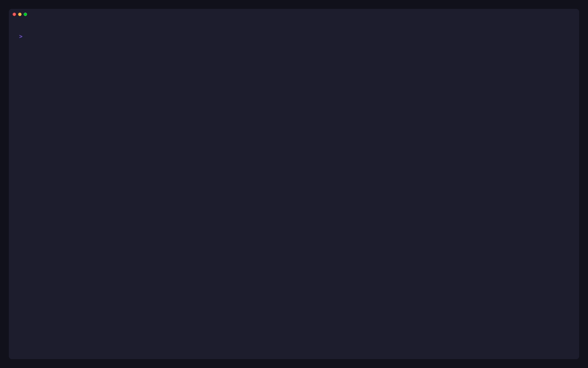

<div align="center">

# p9s

**A terminal UI for Kubernetes policy engines** — in the spirit of [k9s](https://k9scli.io).

Browse policies, violations, admission denials and engine health for
**OPA Gatekeeper**, **Kyverno** and native **ValidatingAdmissionPolicies**,
side by side, straight from your kubeconfig.

[](https://github.com/yindia/p9s/actions/workflows/ci.yml)
[](https://github.com/yindia/p9s/releases)
[](go.mod)
[](https://goreportcard.com/report/github.com/yindia/p9s)

[Install](#-install) · [Quick start](#-quick-start) · [Features](#-features) · [Docs](#-documentation) · [Contributing](#-contributing)

https://github.com/user-attachments/assets/ae210c0c-c1b6-4dce-8591-bb18db81797b

A blocked deploy traced to its Gatekeeper policy, fix and impact, then every view, RBAC, snapshots and the CI gate ([full quality](docs/image/p9s-demo.mp4)).
Prefer the terminal recording? [Here it is](docs/image/demo.gif).

</div>

## ✨ Why p9s

p9s answers the questions a platform or security team asks every day:

- 🩺 **Is the policy layer working?** Fail-open webhooks with no endpoints,
  expiring certificates, crash-looping controllers, stale audits, policies
  that never loaded.
- 👥 **What is violating what, and whose is it?** Violations grouped by the
  Deployment or CronJob that owns them, or by team label.
- 💥 **What would break if this policy enforced?** The objects a policy would
  reject today, by namespace and owner.
- 🚫 **What was just blocked?** Recent admission denials, with the user who
  made the request where the engine records it (Gatekeeper does; Kyverno's
  Events do not).
- 🛠️ **How do I fix it?** A violation's detail carries the policy's own
  remediation text.
- 📄 **Can I hand this to security?** `p9s report` writes Markdown, HTML or
  JSON with Pod Security Standards coverage and health findings.

And it stays out of the way:

- 🔒 **Read-only.** Nothing to install in the cluster; p9s never creates,
  changes or deletes anything.
- ⚡ **Live.** Informers, not polling, with trimmed caches.
- 🔐 **RBAC-aware.** Works with whatever you may read, down to a single
  namespace, and says what it could not see.
- 📸 **Offline.** Record a snapshot and browse it anywhere, or run the same
  views as `p9s get` in scripts and CI.

## 🎯 Features

| | |
|---|---|
| 🩺 **Health dashboard** | Webhooks (failure policy, ready endpoints, certificate expiry), controllers, audit freshness and policies that never loaded, worst first. |
| 👥 **Violations by owner** | A Deployment with 30 violating Pods is one row; group by the owners' `team` label instead with `--group-label team`. |
| 🛠️ **How to fix** | A violation's detail carries the policy's own remediation text from Kyverno and gatekeeper-library metadata. |
| 💥 **Enforcement impact** | What moving a policy from audit to enforce would reject today, by namespace and owner. |
| 🚫 **Recent denials** | What was blocked or flagged at admission, from the engines' Events, with the requesting user where the engine records it. |
| 🧩 **Engine views** | Constraint templates with highlighted Rego and CEL, constraints, Kyverno policies and reports, VAPs and their bindings. |
| ⌨️ **Scriptable** | Every view prints as a table or JSON with `p9s get`; `p9s report` writes Markdown, HTML or JSON and can gate CI. |
| 📸 **Offline** | `p9s snapshot` records a cluster; `--snapshot` replays it through the same views anywhere. |

<table>
  <tr>
    <td width="50%"><br><sub><b>How to fix</b>: the detail of a violation</sub></td>
    <td width="50%"><br><sub><b>Impact</b>: what enforcing a policy would block</sub></td>
  </tr>
  <tr>
    <td width="50%"><br><sub><b>Recent denials</b>: blocked requests and who made them</sub></td>
    <td width="50%"><br><sub><b>VAPs</b>: native policies, bindings and CEL</sub></td>
  </tr>
</table>

## 🧩 Supported engines

| Engine | What p9s reads | Violations from |
|---|---|---|
| **OPA Gatekeeper** | ConstraintTemplates (Rego and CEL), constraints of every kind, the Config | constraint audit results |
| **Kyverno** | ClusterPolicies and Policies, and the CEL `policies.kyverno.io` family | PolicyReports |
| **ValidatingAdmissionPolicy** | native policies and bindings (`admissionregistration.k8s.io/v1`, Kubernetes 1.30+) | PolicyReports Kyverno writes for them, when enabled |

Engines are found through discovery and can run side by side; shared
views merge them with an `ENGINE` column. Policies that Gatekeeper or
Kyverno generate as VAPs are recognised and counted once, under their
source. CI runs the end-to-end suite on kind against the current
Gatekeeper and Kyverno Helm charts; the recordings here show Gatekeeper
v3.23 and Kyverno v1.19. Details per engine: [docs/engines.md](docs/engines.md).

## 📦 Install

**🍺 Homebrew** (the formula lives in this repository):

```sh
brew tap yindia/p9s https://github.com/yindia/p9s
brew install p9s
```

**📜 Install script** (macOS and Linux, amd64/arm64; verifies the release
checksum):

```sh
curl -sSfL https://raw.githubusercontent.com/yindia/p9s/main/install.sh | sh -s -- -b /usr/local/bin
# a specific release: ... | sh -s -- -b /usr/local/bin vX.Y.Z
```

**🐹 Go**:

```sh
go install github.com/yindia/p9s/cmd/p9s@latest
```

**📥 Binaries** for macOS, Linux and Windows (amd64/arm64) are attached to
every [release](https://github.com/yindia/p9s/releases), with
`checksums.txt`. From a checkout: `make build && ./bin/p9s`.

## 🚀 Quick start

```sh
p9s                          # current context, every engine it finds
p9s --context prod           # another kubeconfig context
p9s --group-label team       # group violations by the owners' team label
```

Your first five minutes:

| Press | To |
|---|---|
| `:v` | list violations, grouped by owner; `enter` expands a group |
| `d` | describe the selected row: for a violation, the target, policy and **how to fix** |
| `i` | see what enforcing the selected policy would block |
| `]` | switch `:v` to recent admission denials (`[` goes back) |
| `:health` | check webhooks, controllers, audits and policies |
| `/` | filter: free text or `engine:kyverno mode:audit ns:payments` |
| `?` | every command and key; `:q` quits |

The same views without the TUI:

```sh
p9s get v -n payments -o json                 # any view, as a table or JSON
p9s report --format html -o report.html       # a self-contained security report
p9s report --fail-on critical                 # exit 3 on critical findings, for CI
p9s snapshot -o prod.json                     # record now, browse later with --snapshot
```

> [!TIP]
> No cluster handy? `make e2e-up` builds a kind cluster with Gatekeeper and
> the gatekeeper-library, Kyverno with the restricted Pod Security policies,
> demo workloads and native VAPs: what every recording here shows.

## ⚙️ How it works

- 🔒 **Read-only.** p9s lists and watches with your kubeconfig identity and
  never creates, changes or deletes anything. Nothing runs in the cluster.
- ⚡ **Informers, not polling.** Caches drop `managedFields` and kubectl's
  last-applied copy; owners come from metadata-only informers.
- 🔐 **RBAC-aware.** A forbidden resource becomes a notice and everything
  else still renders; with namespace-only access p9s falls back to that
  namespace. See [docs/rbac.md](docs/rbac.md).
- 🎯 **Honest numbers.** A count the engine cannot provide is `-`, never 0,
  and a capped Gatekeeper list says "showing N of M".

Engines plug in behind one interface, and the TUI, `get` and `report` all
render the same materialised views: [docs/architecture.md](docs/architecture.md).

## 📖 Documentation

| Guide | Covers |
|---|---|
| [Using the TUI](docs/tui.md) | every view, commands, keys, filtering, namespace scope, reading tables |
| [Command line](docs/cli.md) | `get`, `snapshot`, `report`, the config file and flags |
| [Engines](docs/engines.md) | detection, what each engine reports, engine views, generated VAPs |
| [Access and RBAC](docs/rbac.md) | what p9s needs, namespace-only tenants, redaction |
| [Architecture](docs/architecture.md) | layers, data flow and repository layout |
| [Adding an engine](docs/adding-an-engine.md) | the engine interface, informers, contract tests |
| [Development](docs/development.md) | the kind cluster, recordings and releases |

## 🤝 Contributing

Issues and pull requests are welcome. Start with
[CONTRIBUTING.md](CONTRIBUTING.md) for setup, the checks CI runs and commit
conventions (signed off, DCO). [AGENTS.md](AGENTS.md) holds the rules the
code follows, for people and coding agents alike.

- 🐛 Found a bug? [Open an issue](https://github.com/yindia/p9s/issues/new?template=bug_report.md)
  (a `p9s snapshot` of the cluster helps; Secret values are never recorded).
- 💡 Want a view, an engine or a question answered?
  [Request a feature](https://github.com/yindia/p9s/issues/new?template=feature_request.md).

## 🔒 Security

Please report vulnerabilities privately through
[GitHub security advisories](https://github.com/yindia/p9s/security/advisories/new),
not in a public issue. See [SECURITY.md](SECURITY.md).

## 🙏 Acknowledgements

- [k9s](https://k9scli.io), whose keys and feel p9s follows.
- [Bubble Tea](https://github.com/charmbracelet/bubbletea),
  [Lip Gloss](https://github.com/charmbracelet/lipgloss) and
  [VHS](https://github.com/charmbracelet/vhs) from Charm.
- [OPA Gatekeeper](https://open-policy-agent.github.io/gatekeeper/) with the
  [gatekeeper-library](https://github.com/open-policy-agent/gatekeeper-library),
  and [Kyverno](https://kyverno.io) with its policies, which the e2e cluster runs.

<div align="center">

If p9s saves you a `kubectl get constraints -o yaml`, a ⭐ helps others find it.

</div>
