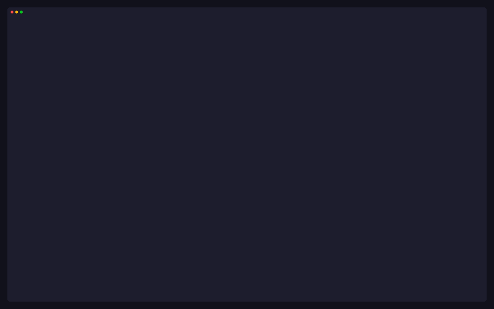
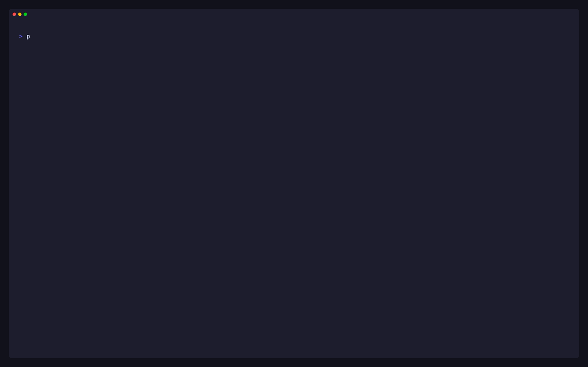
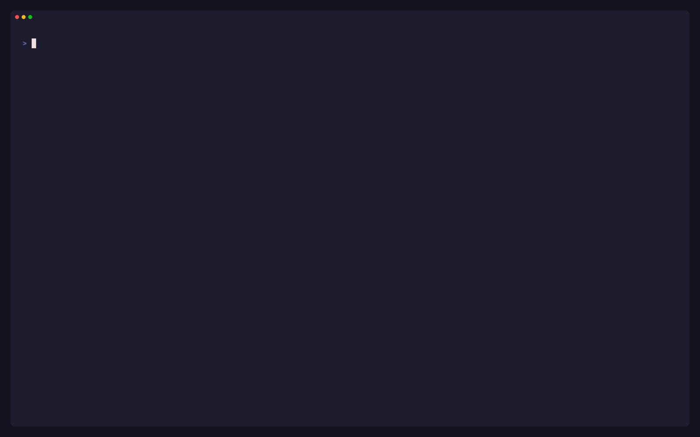

# Command line

Besides the TUI, p9s prints any view as a table or JSON (`get`), records a
cluster for offline use (`snapshot`) and writes a security report
(`report`). All of them are read-only and use the same engines and views
as the TUI.

## `p9s get`



`p9s get <view>` prints the table the TUI shows, with the same columns,
default sort and filters, after every cache has synced.

```sh
p9s get pol
p9s get v -n payments --filter 'engine:kyverno sev:high'
p9s get impact require-team-label -o json
p9s get health -o json
p9s get v --flat                          # one row per violation (o in the TUI)
p9s --group-label team get v --by-label   # grouped by team (t in the TUI)
p9s --context prod get gk/c
```

- Any `:` view works: `pol`, `v`, `events`, `mut`, `health`, `overview`,
  `ns`, `ctx`, `impact <policy>`, `gk/ct`, `kyv/polr`, `vap/pol`, ….
- `-o table` prints aligned text without truncation (it pipes into `grep`
  and `awk`); `-o json` prints the versioned `p9s/v1` table.
- `-n` is the namespace scope, `--filter` the `/` terms, `--sync-timeout`
  how long to wait for caches. `--flat` and `--by-label` pick the `:v`
  layouts the TUI reaches with `o` and `t`.
- A filter that cannot match (a `sev:` on a view without a severity
  column, a mistyped `mode:` or `sev:` value) is an error, so a typo never
  reads as "no violations" in CI. An unknown `key:` is matched as free
  text, with a note on stderr.
- RBAC notices and partial data are printed with the table, never hidden.

## `p9s snapshot`



```sh
p9s --context prod snapshot -o prod.json
p9s --snapshot prod.json                  # the TUI, offline
p9s --snapshot prod.json get v -o json
p9s --snapshot prod.json report
```

`snapshot` syncs like the TUI and records every answer the engines and
watchers received from the API server (lists, watches, gets, RBAC denials
and discovery). `--snapshot` replays it through the same engines, so every
view, detail and filter works as it did. The header shows
`snapshot <time>`, and ages are as of that time.

The file (`p9s/snapshot/v1`, mode `0600`) never carries Secret or ConfigMap
data, container env values, `managedFields` or kubectl's last-applied copy.
Policies, reports and workload specs are recorded as read: share it as you
would their `kubectl get -o yaml`.

## `p9s report`



```sh
p9s report                                   # Markdown to stdout
p9s report --format html -o report.html      # one self-contained page
p9s report --context prod,staging --format json -o today.json
p9s report --all-contexts --since yesterday.json --fail-on critical
```

| Section | Contents |
|---|---|
| Summary | policies by enforcement, violation totals (the engines' own counts; policies without audit data counted separately), health grades |
| Pod Security Standards | each baseline and restricted control as enforced, audit only or missing, from policy metadata only (Kyverno PSS policies with their category annotation; gatekeeper-library PSP templates). Caveats mark parameter-dependent templates and exclusions; nothing is guessed, the rest is "uncategorised" |
| Violations | by severity (policy metadata), namespace and owner; capped Gatekeeper lists are flagged |
| Health findings | fail-open webhooks and every other critical or warning check |
| Unprotected kinds | served kinds no validating policy selects (approximate) |
| Changes (`--since`) | new, resolved and re-worded violations, added and removed policies, enforcement changes |

The header carries the cluster, context, engines, time, p9s version and a
`bodySHA256`. To verify a JSON report, set `header.bodySHA256` to `""`,
re-encode the entry with Go's `json.Marshal` and compare its SHA-256. HTML
is one file with inline CSS and no scripts. A context that cannot be
reached is listed with its error and the others are still reported.

| Exit code | Meaning |
|---|---|
| 0 | report written |
| 1 | error, or a context failed |
| 3 | written, and a finding is at or above `--fail-on critical\|warning` (printed without `Error:`; 2 is what Go uses for a crash) |

Not included yet: the exemptions inventory, who can change policy, and
unprotected namespaces. The report says so.

## Config file

`~/.config/p9s/config.yaml` (or `$XDG_CONFIG_HOME/p9s/config.yaml`, or
`--config <file>`). Every key is optional. Flags win over the file, and a
context's section wins over the top level.

```yaml
startView: v            # like -c
groupLabel: team        # like --group-label
engines: auto           # like --engine
syncTimeout: 90s        # get, snapshot, report
sort:                   # per view: name | violations | age | severity [asc|desc]
  pol: name
  v: violations desc
contexts:
  prod-tokyo-1:
    startView: health
```

Unknown keys and bad values are errors that name the key and line.

## Flags

| Flag | Default | |
|---|---|---|
| `--kubeconfig` | `$KUBECONFIG` / `~/.kube/config` | kubeconfig path |
| `--context` | current context | context to open (`report`: a comma-separated list) |
| `--engine` | `auto` | engines to load: `auto`, or a list of `gatekeeper,kyverno,vap` |
| `-c, --command` | `overview` | the first view |
| `--group-label` | | group violations by this label on their owner |
| `--snapshot <file>` | | read a snapshot instead of a cluster |
| `--config <file>` | `~/.config/p9s/config.yaml` | config file |
| `--log-file <file>` | discarded | client-go logs |

`p9s version` (or `--version`) prints the version; a `go install` build
reports the module version it was installed at.

p9s is read-only: it never creates, changes or deletes anything in a
cluster.
