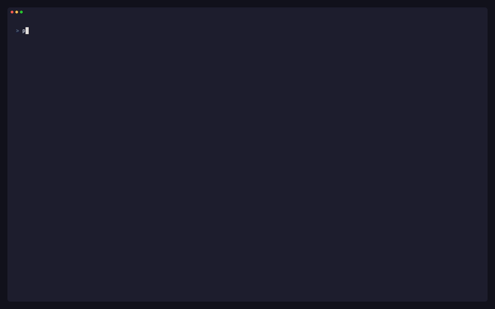

# Access and RBAC

p9s works with whatever your identity may read and says what it could not:

- A forbidden resource is a notice above the affected table
  (`! kyverno: forbidden to list clusterpolicies.kyverno.io …`); everything
  else still renders, and a denial never blocks sync.
- **Namespace-only access**: with a namespace set on the kubeconfig
  context, p9s falls back to watching namespaced resources (PolicyReports,
  Pods, ReplicaSets, …) in that namespace when it may not list them
  cluster-wide. A tenant with the built-in `view` role therefore sees their
  violations and owners. When a policy itself is not readable, its
  violations still show, enforcement reads `n/a` and the detail says why.
  Gatekeeper keeps violations on cluster-scoped constraints, so it shows
  nothing without access to them.
- `y` and `e` redact Secret values.
- A cluster without any engine shows an empty state that says so; an
  unreachable context opens `:ctx` with the error.

