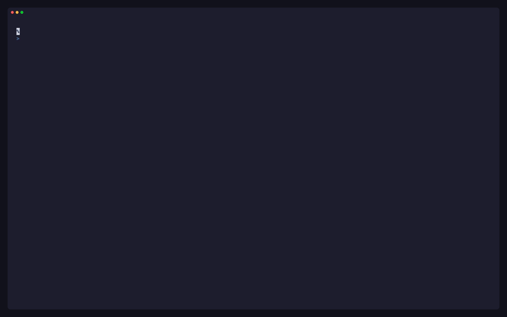
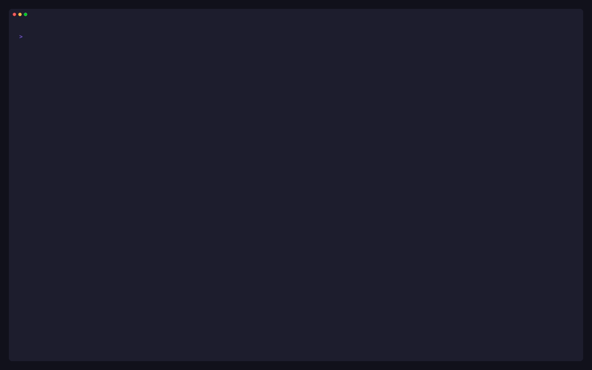
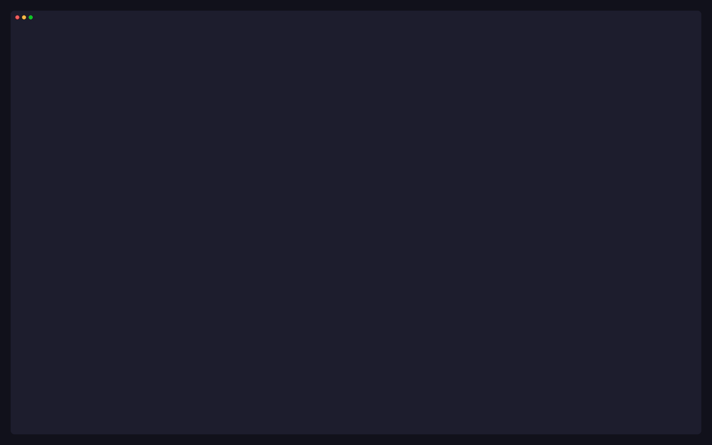
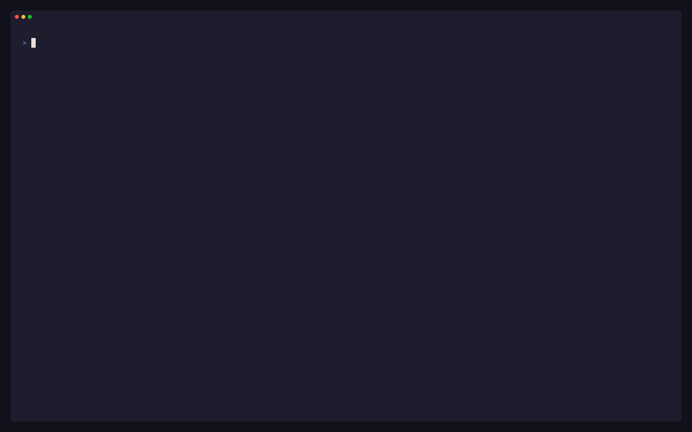
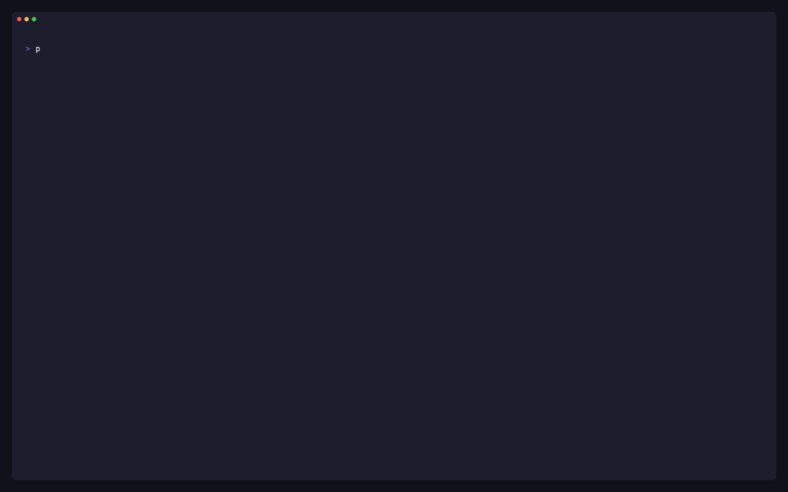

# Using the TUI

p9s opens on the [overview](#overview). Every view is a `:` command away,
`?` lists them all, and the same views print as tables with
[`p9s get`](cli.md#p9s-get). Engine-specific views (`:gk/…`, `:kyv/…`,
`:vap/…`) are described in [engines.md](engines.md#engine-views).


## Overview

The start view (`:overview`, `:ov`) answers "is the policy layer working,
and what should I look at first" on one screen. `j`/`k` select a block,
`enter` opens it, `esc` comes back.

| Block | Shows | `enter` opens |
|---|---|---|
| Health | critical / warning / ok counts and the worst checks | `:health` |
| Top violating owners | the owners (Deployments, CronJobs, …) with most affected objects | `:v` |
| Enforcement candidates | policies in audit or warn mode, fewest violations first: those with none can enforce without blocking anything that exists today | `:pol /mode:audit,warn` |
| Recent admission denials | the latest requests a policy blocked | `:events` |

The overview follows the `:ns` scope.


## Violations by owner

`:v` and a policy's drill-down group violations by the target's
**top-level owner**, so a Deployment with 30 violating Pods is one row with
`OBJECTS 30`:

```
  ENGINE      OWNER                         POLICY                      KIND          ACTION   SEVERITY  OBJECTS↓  MESSAGE
▸ gatekeeper  Deployment/p9s-demo/checkout  container-must-have-limits  K8sContainer… enforce  -         3         container <web> has no resource limits
```

- Owners come from controller ownerReferences: Pod → ReplicaSet →
  Deployment, Pod → Job → CronJob, Pod → StatefulSet, Pod → DaemonSet.
  The original target is kept.
- `enter` expands a group, `g` goes to the owner, `o` switches to the flat
  list (one row per violation).
- Ownership uses metadata-only informers (about 3 MiB on the e2e cluster).
  If RBAC hides some kinds, violations group under the deepest owner p9s
  can see and a notice names the missing kinds.



## Violation detail and how to fix



`d` on a violation is written for the developer who has to fix it: the full
message, the target and its owner, the policy with its normalised
enforcement, and **How to fix**, taken from the policy's own metadata:

- Kyverno: `policies.kyverno.io/title` and `policies.kyverno.io/description`.
- Gatekeeper: the constraint's `description` annotation, then the
  template's `metadata.gatekeeper.sh/title` and `description` (set by
  gatekeeper-library).

Each item says where it came from; a policy without any says so. `y` shows
the policy's YAML and `g` goes to the target.

## Enforcement impact



`i` on any policy or violation row (or `:impact <policy>`) shows what
moving the policy to enforce would block: its current violations by
namespace, then owner.

- The headline uses the engine's own total. When Gatekeeper lists fewer
  violations than it counts, the view says "showing N of M" and its groups
  cover only the listed ones. A capped list is never shown as complete.
- `MANAGED` says how each owner would be hit: `controller` (new Pods and
  rollouts may be rejected), `bare` (its next update may be), or `-` when
  p9s cannot see its owners.
- Enforcing rejects matching creates and updates; running objects keep
  running. No audit data means the impact is unknown, not zero.
- The view is cluster-wide. `enter` lists an owner's violations.

## Recent admission events



Audit results say what is wrong **now**. The recent tab of `:v` (`]`, or
`:events`) says what was **blocked or flagged at admission**, from the
Events the engines write: time, engine, policy, action, user, target and
message. `[` returns to the audit results with their grouping.

- **Gatekeeper** writes `FailedAdmission`, `WarningAdmission` and
  `DryrunViolation` Events, **only with `--emit-admission-events`** (Helm
  `emitAdmissionEvents=true`). p9s reads the flag and says when it is off.
- **Kyverno** writes `PolicyViolation` Events from `kyverno-admission`.
  `ACTION` is `enforce` when the request was blocked and `audit`/`warn`
  when it was let through. Kyverno does not record the user.
- Only matching Events are cached (server-side field selectors). Events
  expire (`--event-ttl`, 1 hour by default), so this is recent history.
  Server-side dry runs are recorded like real requests; denials by
  ValidatingAdmissionPolicies (native or generated) are not recorded as
  Events, and the tab says so when the `vap` engine is active.

## Health dashboard

`:health` checks the policy layer itself, worst first. `tab` moves between
panels, `enter` opens a row's detail, `g` goes to the object behind it.

```
  OVERALL   ✗ 2 critical   ! 1 warning   ✓ 25 ok                                      refreshed 2s ago
─ Webhooks [11] ────────────────────────────────────────────────────────────────────────────────────
  ENGINE      WEBHOOK                    FAILURE  TIMEOUT  ENDPOINTS  CERT   STATUS
▸ gatekeeper  fail-open.p9s.example      Ignore   3s       0/0        -      ✗ fail-open, no endpoints
  gatekeeper  validation.gatekeeper.sh   Ignore   3s       3/3        3649d  ✓
```

| Panel | Shows | ✗ critical / ! warning |
|---|---|---|
| Webhooks | each webhook of the engines: failure policy, timeout, ready endpoints / total, earliest certificate expiry | ✗ `Ignore` with no ready endpoints (policy silently bypassed). ! `Fail` with none (admission blocked). ! certificate expiring within 14 days |
| Controllers | the engines' Deployments: ready / desired, restarts, last termination reason, image tag | ✗ none ready. ! a restart in the last hour, or mismatched image tags |
| Audit | source, interval, last run, leader | ! older than 2× the interval, or never run |
| Policies | loaded / total, not enforced, compile errors, missing CRDs, not ready | ✗ a VAP binding to a missing policy, or a missing param that rejects every request. ! any other inactive policy |

The webhook detail explains the failure policy, endpoints with Pod state,
the certificate, namespace and object selectors, rules, and the impact in
one line.



## Commands

| Command | View |
|---|---|
| `:overview` `:ov` | the start view |
| `:pol [engine]` | policies from every active engine |
| `:v [engine]` | violations; `[` `]` switch between audit results and recent admission events |
| `:events` | recent admission events (the recent tab of `:v`) |
| `:impact <policy>` | what enforcing a policy would block (`name`, `kind/name` or `engine:kind/name`) |
| `:mut [engine]` | mutations, from engines that report them |
| `:health` | the health dashboard |
| `:ns [name\|all]` | namespaces with violation counts; picks the [namespace scope](#namespace-scope) |
| `:ctx` | kubeconfig contexts; `enter` switches, and engines are detected again |
| `:gk/…` `:kyv/…` `:vap/…` | [engine views](engines.md#engine-views) |
| `:q` | quit |

`tab` completes commands; `?` lists every command, including engine views.

## Keys

| Key | Action |
|---|---|
| `:` | command mode |
| `/` | filter rows (live); `esc` clears |
| `enter` | drill down or open; else describe |
| `esc` | clear the filter, else go back |
| `d` | describe |
| `y` | YAML (managedFields stripped, Secret values redacted) |
| `e` | open the YAML in `$VISUAL`/`$EDITOR` (read-only: changes are discarded) |
| `g` | go to the object behind the row |
| `c` / `C` | copy `kind/namespace/name`, or a `kubectl get … -o yaml` command (OSC 52, works over SSH) |
| `i` | enforcement impact of the row's policy |
| `N` `V` `A` `S` | sort by name, count (violations on `:pol` and `:v`, the view's own count elsewhere), age, severity; again to reverse |
| `o` | `:v`: owner groups ↔ flat list |
| `[` `]` | `:v`: audit results ↔ recent admission events |
| `G` | `:vap/pol`: show or hide generated policies (there `end` jumps to the last row) |
| `0` | clear the namespace scope |
| `j k ↑ ↓ pgup pgdn home end G` | move |
| `?` | help |
| `ctrl+c` `:q` | quit |

The footer lists only the keys that do something on the current row, and
messages there clear after 4 seconds.

## Filtering

`/` takes free text and column terms, combined with AND:

| Term | Matches |
|---|---|
| `owner` | any cell containing "owner" |
| `engine:kyverno` | the ENGINE column |
| `mode:audit` | the enforcement column (exact word; `mode:n/a` works) |
| `ns:payments` | the NAMESPACE column, or rows whose object is in `payments` |
| `kind:cpol` | the KIND column |
| `sev:error` | the SEVERITY column |
| `name:require` | the NAME or POLICY column |

A comma means "any of": `mode:audit,warn`, `engine:gatekeeper,kyverno` (no
spaces). A term for a column the view lacks matches nothing; unknown keys
(`foo:bar`) are free text, so messages with colons still match.

## Namespace scope

`:ns payments` (or picking a row in `:ns`) scopes every view: violations
whose target is in `payments` (including the `Namespace/payments` object),
cluster-wide policies plus policies in `payments` (their counts cover only
`payments`), and the same for `:health` and `:mut`. `0` or `:ns all`
clears it, as does switching context. The impact view, the health
dashboard's checks and reports stay cluster-wide and say so.

## Header

```
 p9s │ ctx kind-p9s │ ns all │ gatekeeper v3.23.1 · kyverno v1.19.2 · vap builtin │ last audit 28s ago (gatekeeper)   RO
```

The context, the namespace scope, active engines with their versions (from
the controller image, `unknown` if RBAC hides it), and audit freshness.
`last audit` names the engine whose audit is **stalest relative to its own
interval** (Gatekeeper's `--audit-interval`, Kyverno's
`--backgroundScanInterval`), turning amber past 2× and red past 5×.

While caches load, the header reads `syncing…` and counts that may still
change are drawn dimmed with a `~` (`~12`).

## Reading tables

- **Enforcement** is one word: `enforce`, `warn`, `audit`, `mutate` or
  `n/a`. The engine's own term is in the detail: `enforce (engine: deny)`.
- **`-` means not applicable or unknown** (a never-audited policy has no
  count). A dimmed `0` means none.
- **Names first**; kinds follow, dimmed and shortened.
- The active sort is marked in the header (`VIOLATIONS↓`), and the selected
  row's full message is under the table (`» …`).
